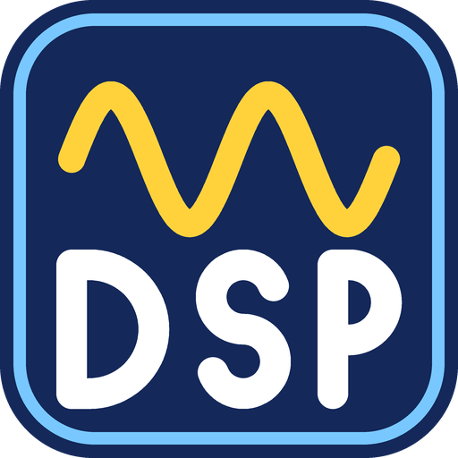

<p align="center"></p>

# OpenDSP

OpenDSP replaces the DSP firmware used by libctru's ndsp on the Nintendo 3DS.
Link it into your homebrew and users won't need to dump `dspfirm.cdc` or put it
on their SD card. It was written from scratch and contains no Nintendo firmware code.

## Getting started

With devkitPro and libctru installed:

```sh
make -C library install
```

Add OpenDSP to your Makefile:

```make
LIBS    := -lopendsp -lctru -lm
LIBDIRS := $(PORTLIBS) $(CTRULIB)
```

Include `<opendsp.h>`, use `opendspInit()` instead of `ndspInit()`, and call
`opendspExit()` when you're done. Your other ndsp calls stay the same.
[The guide](docs/GUIDE.md) covers adding it directly to a project.

## Audio and effects

OpenDSP supports 24 voices, PCM8/PCM16, DSP-ADPCM, mono/stereo, looping buffers,
all three interpolation modes, filters, mixing, capture and sleep/wake.
Surround output is currently mixed down to stereo; the rear ratio still works.

Reverb and delay run on the DSP through ndsp's two aux buses. Include
`<opendsp/effects.h>` to configure them. The [guide](docs/GUIDE.md#reverb-and-delay)
has an example, and Sound Lab includes Room, Hall, Plate and Cave presets.

## AAC

AAC-LC decoding uses the DSP by default when it's available. ARM11 remains
available for standalone decoding and formats outside the DSP's limits.
Use `<opendsp/aac.h>`; [AAC.md](docs/AAC.md) has the details.

## Sound Lab

[Sound Lab](examples/soundlab) lets you try music, sound effects, WAV files,
filters and effects. It also shows DSP load.

Build it with
`make -C examples/soundlab` or `make -C examples/soundlab cia`.

Tested on a New Nintendo 3DS with Luma3DS. The library includes the firmware;
see [BUILDING.md](docs/BUILDING.md) if you want to change it.

## License

BSD 2-Clause. Include the copyright notice and license text when distributing OpenDSP.

Made by Cellenseres. Thanks to Gericom for teak-llvm, wwylele for teakra,
and the devkitPro and libctru developers.

OpenDSP is not affiliated with Nintendo.
